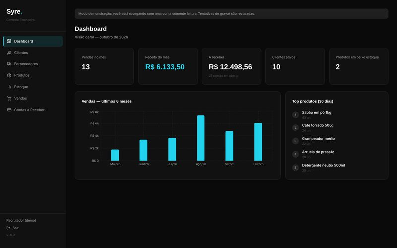
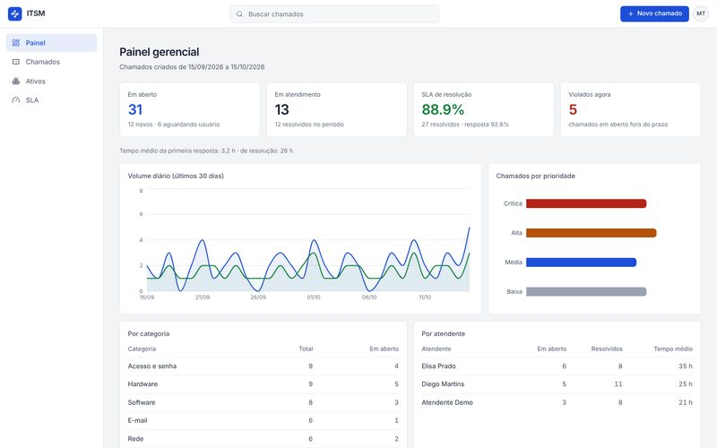
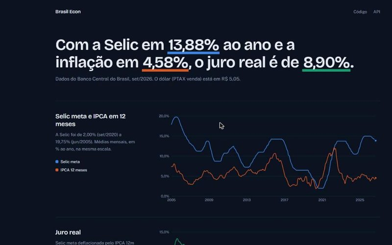

<h1 align="center">Matheus Ansel</h1>

  <b>Desenvolvedor Backend e Full Stack</b> · Rio de Janeiro 
  Node.js · TypeScript · React · PostgreSQL

  Do banco de dados à interface e ao deploy: APIs REST com autenticação e controle de acesso, testes automatizados e CI/CD. 
  Aberto a vagas de <b>Desenvolvedor Back-end, Full Stack ou Analista de Sistemas</b>, remoto ou no Rio de Janeiro.

  
  
  

## Projetos em destaque

<table>
<tr>
<td width="50%" valign="top">

<h3>Sistema para Oficina Mecânica</h3>
<b>Cliente real, em produção.</b> A oficina, em Irajá (RJ), não aparecia nas pesquisas e não tinha registro centralizado dos veículos. Fiz sozinho, do levantamento com o dono ao deploy: site com domínio próprio, páginas por serviço e SEO local verificado no Google Search Console, e gestão de ordens de serviço, clientes e veículos com Row Level Security, testes e CI. Infraestrutura no nome do cliente, com deploy sem acesso à conta dele. Vendido por contrato e já com mais de 20 veículos cadastrados. Orçamento pelo WhatsApp Cloud API pronto para ativação.
  
Next.js 15 · React 19 · TypeScript · PostgreSQL · Redis
  

</td>
<td width="50%" valign="top">

<h3>Syre</h3>
Controle financeiro com clientes, fornecedores, estoque, vendas e contas a receber. <b>280 testes automatizados</b>, refresh token rotativo, perfis de acesso e API em OpenAPI.
  
React · Node.js · Express · PostgreSQL
  

</td>
</tr>
<tr>
<td width="50%" valign="top">

<h3>ITSM</h3>
Service desk com chamados, SLA e fechamento automático, ativos de TI e trilha de auditoria. <b>Testes unitários, de integração contra PostgreSQL real e no navegador</b> (Playwright).
  
NestJS · Prisma · PostgreSQL · Next.js · Docker
  

</td>
<td width="50%" valign="top">

<h3>brasil-econ-dashboard</h3>
Dados reais do Banco Central: ETL agendado e idempotente, API com cache em Redis e OpenAPI, análise de Selic, inflação e juro real. <b>87 testes contra PostgreSQL e Redis reais.</b>
  
Node.js · TypeScript · PostgreSQL · Redis · Next.js
  

</td>
</tr>
</table>

CI no GitHub Actions (tipos, lint, testes e build) em 4 projetos. ITSM, Syre e brasil-econ-dashboard têm as principais decisões de arquitetura registradas em ADRs, na pasta `docs/adr` de cada repositório.

**Também no GitHub:** [Telecall / ConnectCall](https://github.com/MatheusAnsel/ConnectCall), projeto acadêmico em PHP e MySQL revisitado com uma auditoria de segurança: prepared statements, senhas com bcrypt, correção de IDOR e CI que impede a volta dessas falhas.

## Sobre mim

Desenvolvedor Backend e Full Stack, do banco de dados à interface e ao deploy. Desde 2024 desenvolvo, como autônomo, sistemas para clientes reais e projetos próprios.

Atuo em suporte técnico de TI desde 2019, o que me ensinou a partir do problema real do usuário: atendimento presencial e por acesso remoto (TeamViewer), instalação e formatação de Windows e Linux, Microsoft 365, montagem, troca de peças, remoção de vírus e correção de lentidão.

Também trabalho com dados: SQL, Python com pandas, Excel avançado com tabelas dinâmicas e Power Query, e Power BI, aplicados no brasil-econ-dashboard. Certificado pela Cisco em análise de dados e Data Science com Python.

Como voluntário, coordenei por quase dois anos a equipe de moderação de uma comunidade online com cerca de 230 membros ativos por dia; a equipe cresceu de 8 para até 56 pessoas.

Inglês técnico intermediário.

## Stack

| Área | Ferramentas |
|---|---|
| Back-end | Node.js, Express, NestJS, Fastify, APIs REST, OpenAPI, JWT, Prisma, Zod, Clean Architecture |
| Front-end | React, Next.js (App Router), TypeScript, Tailwind CSS |
| Banco de dados | PostgreSQL, Redis, MySQL, modelagem relacional, migrações |
| Dados | SQL, Python (pandas), Excel avançado (tabelas dinâmicas, Power Query), Power BI |
| Infraestrutura | Docker, Docker Compose, Git, GitHub Actions, Vercel, Render, Supabase |
| Segurança e testes | Refresh token rotativo, perfis de acesso, RLS, HMAC, rate limiting, Vitest, Jest, Supertest, Playwright |

## Formação

- Tecnologia em Análise e Desenvolvimento de Sistemas, UNISUAM (2022 a 2024)

## Certificações e cursos

- Fundamentos da Análise de Dados, Cisco Networking Academy (2026)
- Data Science Essentials with Python, Cisco Networking Academy (2026)
- AWS Cloud Practitioner Essentials, Amazon Web Services (2026, curso com certificado de conclusão)
- Conceitos Básicos de Redes, Cisco Networking Academy (2026)
- Certificação do Google Analytics, Google (2026)
- AI Foundations e Applied AI Foundations, OpenAI (2026)
- AI Fluency: Framework and Foundations, Claude 101 e Introduction to Claude Cowork, Anthropic (2026)
- Introdução à Plataforma Java, DIO (2026)
- Fundamentos de Programação com C# e .NET, Udemy (2026)

Códigos e links de verificação na seção [Licenças e certificados do LinkedIn](https://www.linkedin.com/in/matheusansel/details/certifications/).
