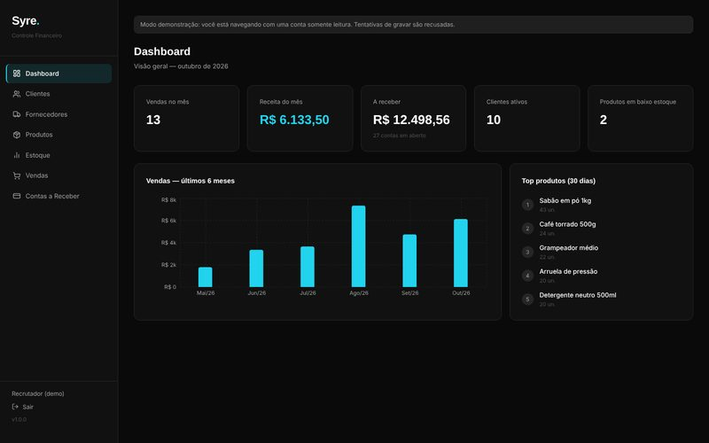
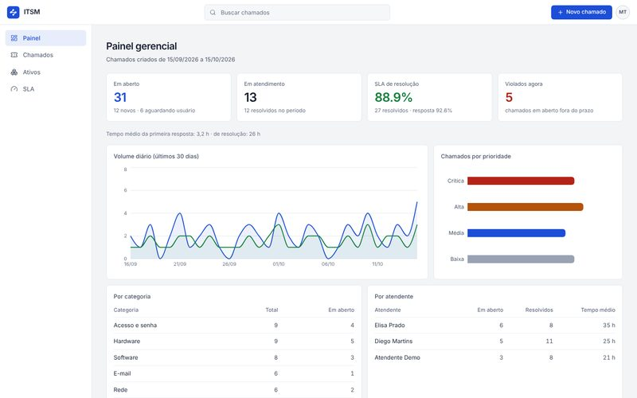
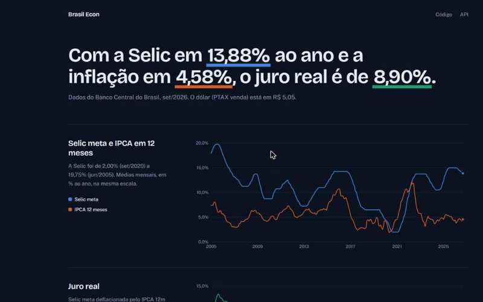
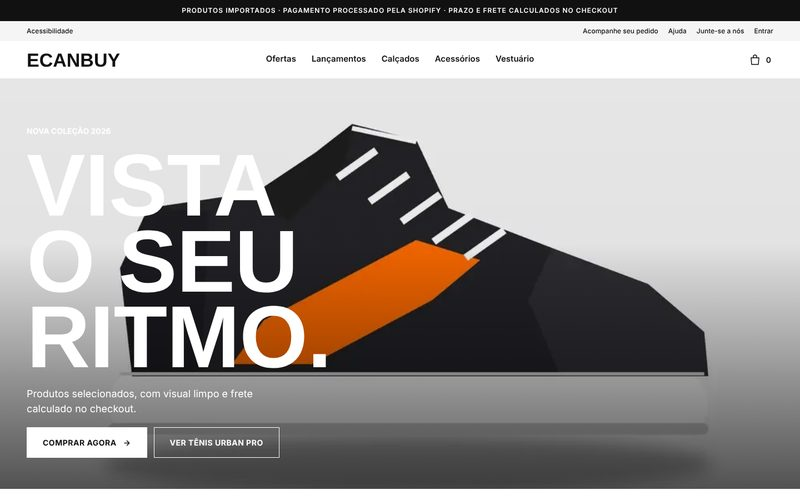
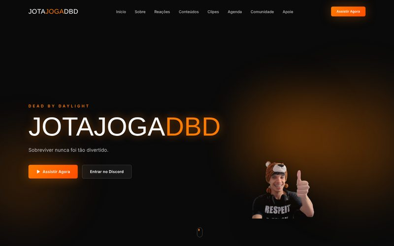

<h1 align="center">Matheus Ansel</h1>

  <b>Desenvolvedor Backend e Full Stack Júnior</b> · Rio de Janeiro 
  Node.js · TypeScript · React · PostgreSQL

  Construo sistemas web completos, com APIs seguras, testes automatizados e código em camadas. 
  Disponível para vagas de <b>Desenvolvedor Back-end, Full Stack ou Analista de Sistemas Júnior</b>.

  
  
  

## Projetos em destaque

<table>
<tr>
<td width="50%" valign="top">

<h3>Sistema para Oficina Mecânica</h3>
<b>Cliente real, em produção.</b> Orçamento automatizado pelo WhatsApp Cloud API e gestão de ordens de serviço, clientes e veículos, com Row Level Security, testes e CI.
  
Next.js 15 · React 19 · TypeScript · PostgreSQL · Redis
  

</td>
<td width="50%" valign="top">

<h3>Syre</h3>
Controle financeiro com clientes, fornecedores, estoque, vendas e contas a receber. <b>Mais de 250 testes automatizados</b>, refresh token rotativo, perfis de acesso e API em OpenAPI.
  
React · Node.js · Express · PostgreSQL
  

</td>
</tr>
<tr>
<td width="50%" valign="top">

<h3>ITSM</h3>
Service desk com chamados, SLA e fechamento automático, ativos de TI e trilha de auditoria. <b>Testes unitários, de integração contra PostgreSQL real e no navegador</b> (Playwright).
  
NestJS · Prisma · PostgreSQL · Next.js · Docker
  

</td>
<td width="50%" valign="top">

<h3>brasil-econ-dashboard</h3>
Dados reais do Banco Central: ETL agendado e idempotente, API com cache em Redis e OpenAPI, análise de Selic, inflação e juro real. <b>87 testes contra PostgreSQL e Redis reais.</b>
  
Node.js · TypeScript · PostgreSQL · Redis · Next.js
  

</td>
</tr>
<tr>
<td width="50%" valign="top">

<h3>Ecanbuy</h3>
Loja de dropshipping headless integrada à Shopify Storefront API, com catálogo, carrinho, cupons e checkout.
  
Next.js 16 · React 19 · TypeScript · GraphQL
  

</td>
<td width="50%" valign="top">

<h3>JotaJogaDBD</h3>
<b>Entregue a um criador de conteúdo real</b>, em colaboração com Marina Barbs. Landing page com o conteúdo editável isolado em arquivos de configuração.
  
Next.js · TypeScript · Tailwind CSS
  

</td>
</tr>
</table>

ITSM, Syre e brasil-econ-dashboard têm as principais decisões de arquitetura registradas em ADRs, na pasta `docs/adr` de cada repositório.

**Também no GitHub:** [Telecall / ConnectCall](https://github.com/MatheusAnsel/ConnectCall), projeto acadêmico em PHP e MySQL revisitado com uma auditoria de segurança: prepared statements, senhas com bcrypt, correção de IDOR e CI que impede a volta dessas falhas.

## Sobre mim

Desenvolvedor full stack, do banco de dados à interface. Atuo como desenvolvedor desde 2024 e em suporte técnico de TI desde 2019, com atendimento a usuários e diagnóstico e conserto de computadores, notebooks, impressoras e periféricos.

Reconhecido como Galactic Problem Solver no NASA International Space Apps Challenge 2024. Inglês técnico intermediário.

## Stack

| Área | Ferramentas |
|---|---|
| Back-end | Node.js, Express, NestJS, APIs REST, OpenAPI, JWT, Prisma, Zod, Clean Architecture |
| Front-end | React, Next.js (App Router), TypeScript, Tailwind CSS |
| Banco de dados | PostgreSQL, Redis, MySQL, modelagem relacional, migrações |
| Infraestrutura | Docker, Docker Compose, Git, GitHub Actions, Vercel, Render, Supabase |
| Segurança e testes | bcrypt, rate limiting, Helmet, CORS, RLS, Vitest, Jest, Supertest, Playwright |

## Formação

- Tecnologia em Análise e Desenvolvimento de Sistemas, UNISUAM (2022 a 2024)
- Fundamentos de Programação com C# e .NET, Udemy (2026)
